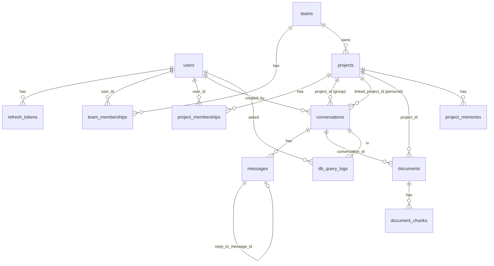

# ۰۴ — مدل داده و migrationها

دیتابیس اصلی: PostgreSQL 16 با افزونه‌ی `vector`. مدل‌ها در `app/features/*/models.py`. دیتابیس جداگانه‌ی SQL Server (راهکاران) در [flows/accounting-query.md](flows/accounting-query.md) توضیح داده شده، نه اینجا.

## نمودار رابطه‌ها

(`schema_hints` مستقل است؛ به هیچ جدول دیگر FK ندارد.)

## جدول‌ها

### `users` (`auth/models.py`)
`id` UUID PK · `email` unique+index · `hashed_password` (bcrypt) · `full_name` nullable · `role` enum `user_role` (`super_admin|admin|user`، پیش‌فرض user) · `created_at`.
رابطه: `team_memberships` (cascade delete-orphan).

### `refresh_tokens`
`id` · `user_id` FK→users **CASCADE** · `token_hash` char(64) unique+index (SHA-256 توکن خام) · `expires_at` · `revoked_at` nullable (null=معتبر) · `created_at`. توکن خام هرگز ذخیره نمی‌شود.

### `teams` (`access_control/models.py`)
`id` · `name` unique · `description` · `created_by` FK→users SET NULL · `created_at`.

### `team_memberships`
`id` · `user_id` FK CASCADE · `team_id` FK CASCADE · `role` enum `team_role` (`leader|member`) · `added_by` FK SET NULL · `created_at` · **unique** `uq_user_team(user_id, team_id)`.

### `projects` (`projects/models.py`)
`id` · `team_id` FK→teams CASCADE · `name` · `description` · `created_by` SET NULL · `created_at` · **unique** `uq_project_team_name(team_id, name)` (نام فقط داخل تیم یکتاست).

### `project_memberships`
`id` · `project_id` FK CASCADE · `user_id` FK CASCADE · `added_by` SET NULL · `created_at` · **unique** `uq_project_user(project_id, user_id)`.
قید «کاربر باید عضو تیمِ پروژه باشد» در **سرویس** است نه DB.

### `conversations` (`chat/models.py`)
`id` · `type` enum `conversation_type` (`personal|project_group`) · `project_id` FK→projects **CASCADE** (فقط group؛ کنترل‌کننده‌ی دسترسی) · `linked_project_id` FK→projects **SET NULL** (فقط personal؛ فقط منبع RAG) · `created_by` FK SET NULL · `title` (پیش‌فرض `"New conversation"`) · `created_at`.
ایندکس: `created_by`, `project_id`. (هیچ CHECK بین type و project_id در DB نیست؛ در schema pydantic `ConversationCreate` اعمال می‌شود.)

### `messages`
`id` · `conversation_id` FK CASCADE · `sender_type` enum `sender_type` (`user|assistant`) · `sender_id` FK SET NULL (null برای assistant) · `content` Text · **`sources` JSONB** (list از `SourceCitation`) · **`artifacts` JSONB** (list از artifact؛ پیش‌فرض `[]`) · `reply_to_message_id` FK→messages SET NULL (پاسخ AI به پیام trigger) · `created_at`.
ترتیب پیام‌ها: `(created_at, id)`. توجه: `created_at` زمان شروع transaction است، نه commit.
⚠️ پیام‌های `tool` و `tool_calls` (دورهای میانی agent) **ذخیره نمی‌شوند**؛ فقط متن نهایی + sources + artifacts.

### `documents` (`documents/models.py`)
`id` · `filename` (≤500) · `file_path` (مسیر روی دیسک؛ ممکن است بین چند سند هم‌محتوا مشترک باشد) · `content_type` · `status` enum `document_status` (`processing|ready|failed|cancelled|unsupported`) · `error_message` · `content_hash` (SHA-256 بایت‌ها، index) · `embedding_model` (مدلی که chunkها با آن ساخته شدند؛ null تا READY) · `project_id` FK CASCADE · `conversation_id` FK CASCADE · `folder_id` FK→`document_folders` CASCADE (null = ریشه‌ی پروژه؛ برای سند گفتگو همیشه null) · `uploaded_by` FK SET NULL · `created_at`.
**CHECK** `ck_document_single_scope`: دقیقاً یکی از `project_id` / `conversation_id` پر باشد.
ایندکس‌ها: `project_id`, `conversation_id`, `content_hash`, و `ix_documents_project_conversation` (در 0004).
رابطه: `chunks` cascade delete-orphan.

### `document_folders` (`documents/models.py`)
درخت پوشه‌های فایل‌منیجر یک پروژه: `id` · `project_id` FK CASCADE · `parent_id` FK خودش CASCADE (null = ریشه) · `name` (≤255) · `created_by` FK SET NULL · `created_at`. فقط سازمان‌دهی است؛ دسترسی را پروژه تعیین می‌کند. یکتایی نام پوشه: ایندکس یکتای `uq_document_folders_name (project_id, coalesce(parent_id, nil-uuid), lower(name))`. یکتایی نام **فایل** در یک پوشه فقط در سرویس چک می‌شود (نه constraint).

### `archive_imports` (`documents/models.py`)
یک `.zip/.rar/.7z` آپلودشده که worker باز می‌کند: `id` · `project_id` FK CASCADE · `folder_id` FK CASCADE (مقصد؛ null = ریشه) · `filename` · `file_path` (فایل موقت؛ پس از پایان null و از دیسک پاک می‌شود) · `status` enum `archive_import_status` (`extracting|done|failed`) · `error_message` · `total_files` / `imported_files` / `skipped_files` · `failed_files` JSONB `[{path,error}]` (سقف ۲۰۰) · `uploaded_by` · `created_at` · `finished_at`. اعضای آرشیو سندهای عادی با وضعیت خودشان‌اند.

### `document_chunks`
`id` · `document_id` FK CASCADE · `content` · `chunk_index` (ترتیب سراسری در سند، نه در صفحه) · `embedding` **`Vector(EMBEDDING_DIMENSIONS)`** · `chunk_metadata` JSONB (`page`, `total_pages`, `chunk_in_page`, `total_chunks_in_page` + metadata صفحه مثل `sheet_name`) · `search_text` Text (نرمال‌شده‌ی `content`) · `search_tsv` tsvector (ستون generated stored از `search_text`).
ایندکس: `document_id`، **HNSW** `ix_document_chunks_embedding_hnsw (embedding vector_cosine_ops)`، **GIN** `ix_document_chunks_search_tsv`، **GIN trigram** `ix_document_chunks_search_text_trgm`.

### `ocr_cache` (`documents/models.py`)
`cache_key` PK (`sha256(بایت‌های تصویر):hash16(مدل vision + prompt OCR)`) · `text` · `vision_model` · `rotation` (SmallInteger، nullable؛ درجه‌ی ساعتگردی که تصویر برای راست‌شدن چرخیده: ۰/۹۰/۱۸۰/۲۷۰، NULL = نامعلوم؛ چون cache hit فراخوانی OCR را رد می‌کند و چرخش را از دست می‌داد) · `created_at`. نتیجه‌ی OCR vision برای یک تصویر/صفحه‌ی رندرشده؛ بین سندها مشترک است و به project/conversation/user وابسته نیست (متن تابع محض بایت‌های تصویر است؛ هیچ chunk/سند/قاعده‌ی دسترسی‌ای در آن نیست). فقط نتیجه‌ی **غیرخالی** ذخیره می‌شود. پاک‌سازی/انقضا ندارد (رشد با تعداد تصویر یکتا؛ دستی: `DELETE FROM ocr_cache`). تغییر `LLM_VISION_MODEL` یا `SYSTEM_OCR_PROMPT` کلید را عوض می‌کند، پس متن قدیمی بازیابی نمی‌شود.

### `project_memories` (`memory/models.py`)
`id` · `project_id` FK CASCADE · `created_by_user_id` FK SET NULL · `fact_text` · `category` enum `memory_category` (`technical_decision|timeline|business_rule|convention`) · `confidence_score` float (پیش‌فرض ۱٫۰؛ **جایی استفاده نمی‌شود**) · `is_verified` bool · `embedding` Vector · `created_at` · `updated_at`. ایندکس: `project_id` و HNSW.

### `schema_hints` (`db_connector/models.py`)
`id` · `hint_key` unique (مثل `view:ledger_lines:1`, `example:012`, `note:fiscal_year`, `taxonomy:003`) · `kind` (`view|example|glossary|note|taxonomy`، index) · `title` · `content` · `views` JSONB · `keywords` JSONB · `content_hash` (SHA-256 از `model\ntitle\ntext`) · `embedding_model` · `embedding` Vector **nullable** · `updated_at`. HNSW روی embedding. سراسری است، نه per-project.

### `db_query_logs`
`id` · `user_id` SET NULL (index) · `conversation_id` SET NULL (index) · `question` · `hint_keys` JSONB · `sql_text` · `attempts` · `status` enum `db_query_status` (`ok|rejected|error`، index) · `error_message` · `row_count` · `truncated` · `duration_ms` · `feedback` smallint (+1 / −1 / null) · `feedback_note` · `created_at` (index).
هر پرسش مالی (حتی ناموفق یا «بی‌پاسخ») یک ردیف می‌سازد؛ ماده‌ی خام بهبود hintها.

### جدول‌های حذف‌شده
`document_permissions` (اشتراک سند بین تیم‌ها، در 0002 حذف شد)، `documents.team_id` (جایش پروژه آمد)، `conversations.user_id` (→`created_by`)، `messages.role` (→`sender_type`).

## Alembic
- `alembic/env.py`: async؛ `sqlalchemy.url` را از `Settings.database_url` می‌گیرد؛ `target_metadata = Base.metadata` پس از import `model_registry`.
- اجرا: `alembic upgrade head` (در compose سرویس `migrate` قبل از backend/worker).
- ⚠️ **ابعاد vector در زمان migration از `settings.embedding_dimensions` خوانده می‌شود** (0001، 0004، 0006). یعنی دیتابیسی که با dimension A ساخته شده با تغییر env به B ناسازگار می‌شود و migration دوباره آن را درست نمی‌کند. تغییر dimension = migration دستی + حذف/ساخت دوباره‌ی ایندکس + ایندکس مجدد اسناد، حافظه‌ها و hintها.
- مقدار پیش‌فرض `config.py` = ۱۵۳۶ و `.env.example` = ۱۵۳۶ (مدل نمونه `bge-m3` ذاتاً ۱۰۲۴ است؛ مقدار واقعی باید با خروجی provider فعلی یکی باشد — نیاز به تأیید روی سرور).

| revision | کار |
|---|---|
| `0001_init` | `vector` extension (و از 0008 `pg_trgm`)؛ users, teams, team_memberships, documents (team-scoped), document_permissions, document_chunks (+HNSW), conversations, messages |
| `0002_projects_chat_roles` | `super_admin`؛ refresh_tokens؛ role/added_by برای team_memberships؛ projects+project_memberships؛ اسناد از team به project (برای هر تیمِ دارای سند، پروژه‌ی «General» ساخته شد)؛ `conversations.type/project_id/linked_project_id`؛ `messages.sender_type/sender_id/reply_to_message_id`. **برگشت‌ناپذیر**. قدیمی‌ترین admin → super_admin. |
| `0003_allow_personal_documents` | CHECK را برای سند «شخصی» (بدون project/conversation ولی با uploaded_by) شل کرد + ایندکس `uploaded_by` |
| `0004_project_memory` | جدول `project_memories` (+HNSW) و ایندکس `ix_documents_project_conversation` |
| `0005_remove_personal_documents` | اسناد بدون scope حذف شدند، CHECK به حالت دقیق برگشت، ایندکس `uploaded_by` حذف |
| `0006_accounting_db_connector` | `schema_hints` و `db_query_logs` |
| `0007_message_artifacts` | ستون `messages.artifacts` |
| `0008_chunk_lexical_search` | افزونه‌ی `pg_trgm`؛ `document_chunks.search_text` (backfill دسته‌ای با همان `normalize` پایتون) و `search_tsv` generated + ایندکس‌های GIN. افزودن ستون generated جدول را یک‌بار بازنویسی می‌کند |
| `0009_ocr_cache` | جدول `ocr_cache` (نتیجه‌ی OCR بر اساس هش تصویر + مدل/prompt) |
| `0010_ocr_cache_rotation` | ستون `ocr_cache.rotation` (چرخش پیداشده برای تصویر) |
| `0011_file_manager` | جدول‌های `document_folders` و `archive_imports`، ستون `documents.folder_id`، مقدارهای `cancelled`/`unsupported` برای `document_status` (در downgrade حذف نمی‌شوند: Postgres حذف مقدار enum را ندارد) |

قواعد: ← [guides/add-migration.md](guides/add-migration.md). تست `tests/test_migrations.py` تضمین می‌کند `upgrade head` دقیقاً همان جدول/ستون‌های `Base.metadata` را می‌سازد (فقط نام ستون‌ها مقایسه می‌شود، نه نوع/ایندکس).
